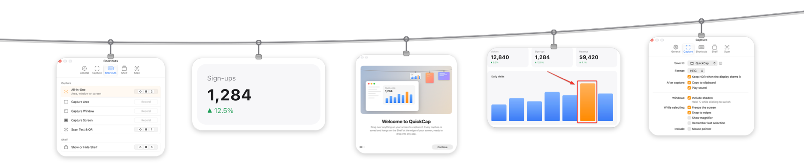
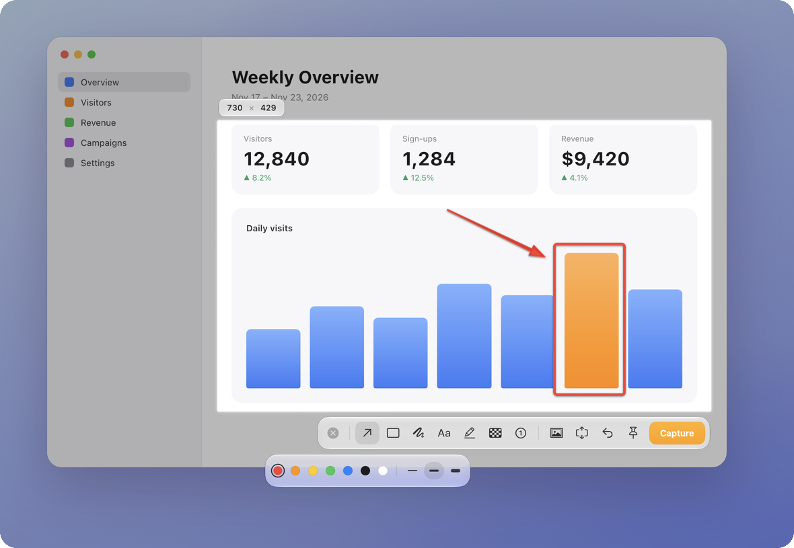
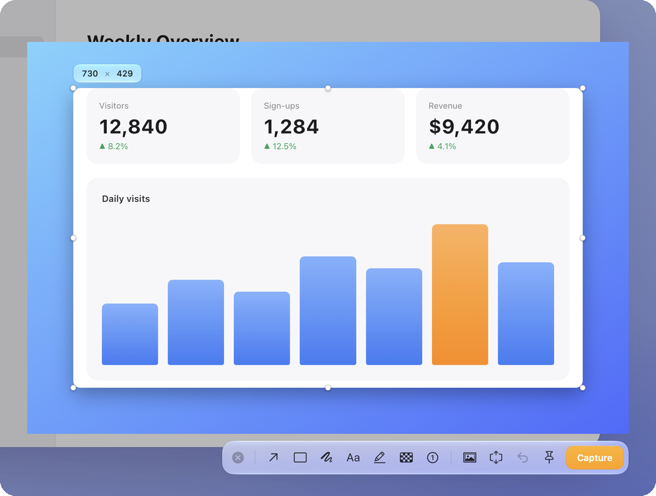
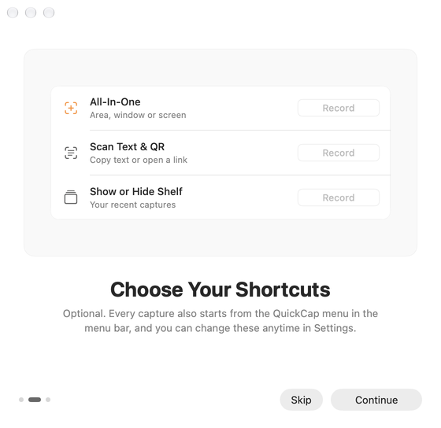
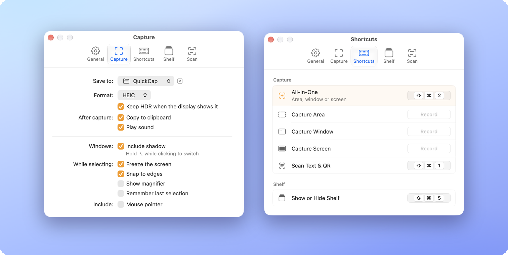

<h1 align="center">QuickCap</h1>

<p align="center">
  Open source native screenshot tool for macOS.<br/>
  Capture an area, window or screen, annotate it, scan text and QR codes,
  and keep every capture hanging on a Shelf at the top of your screen.
</p>

<p align="center">
  <a href="#install">Install</a> ·
  <a href="#features">Features</a> ·
  <a href="README.zh-Hans.md">中文</a>
</p>

---

## Overview

QuickCap lives in the menu bar. Drag over anything on your screen and
the capture flies up onto the **Shelf**: a rope along the top edge of
your screen where screenshots hang on clips. Drag a card into any app,
copy it, pin it to the desktop, or search the text inside it. The Shelf
tucks itself away when you're not using it.

<p align="center">
  
</p>

---

## Features

### Capture and annotate in one place

Pick an area, a window or the whole screen from the same bar. The
screen freezes while you choose, and the selection snaps to window
edges and to lines and shapes inside the picture. Once it's selected,
the tools are right there: arrow, box, pen, text, highlighter, pixelate
and numbered steps. What you see on screen is exactly what gets saved.

<p align="center">
  
</p>

### A backdrop in one click

Press **G** to put the capture on a gradient, your wallpaper, a solid
color or a transparent background, with padding, rounded corners and a
shadow. Ready for a slide, a tweet or a README.

<p align="center">
  
</p>

### More than a screenshot

| | |
|:---|:---|
| **Scan text & QR codes** | Select any area and the text or link is copied. Uses Apple Vision, entirely on your Mac. |
| **Scrolling capture** | Scroll the content yourself and QuickCap stitches it as you go. |
| **Pin to Desktop** | Float a capture above every window. Zoom, fade it to any opacity, or lock it so clicks pass through. Pins come back after a restart, and you can pin whatever image is on the clipboard or mark one up in place. |
| **Window captures** | Keep the real macOS shadow (hold ⌥ to leave it out), on a transparent background or your desktop wallpaper, dynamic ones included. |
| **HDR** | On HDR displays, captures keep their HDR brightness (HEIC with a gain map). |
| **Timer** | 3, 5 or 10 seconds, for menus and hover states. |

### Your shortcuts, your choice

QuickCap doesn't take over any keys. The welcome window lets you pick
shortcuts for All-In-One, Scan and the Shelf, or skip it and start
every capture from the menu bar. Change them anytime in Settings.

<p align="center">
  
</p>

### Settings that stay out of the way

Save location, format (HEIC, PNG or JPEG), scale Retina captures to 1×,
convert to sRGB, hide desktop icons, snap to buttons and fields, copy and
save together, Shelf side and auto-hide, scan language, open at login.

<p align="center">
  
</p>

---

## Install

1. Download the latest `QuickCap-<ver>.dmg` or `QuickCap-<ver>.app.zip`
   from the [Releases](https://github.com/AaronKhoolb/QuickCap/releases)
   page.
2. Open the DMG (or unzip) and drag **QuickCap** to `/Applications`.
3. The app isn't notarized, so macOS blocks the first launch. Either
   open it once, then go to **System Settings → Privacy & Security** and
   click **Open Anyway**, or run:
   ```
   xattr -dr com.apple.quarantine /Applications/QuickCap.app
   ```
4. Open QuickCap. The welcome window walks you through the rest.

Requires macOS 26 (Tahoe) or newer, Apple Silicon.

---

## License

MIT, see [LICENSE](LICENSE).

---

## Contributors

<a href="https://github.com/AaronKhoolb/QuickCap/graphs/contributors">
  
</a>
