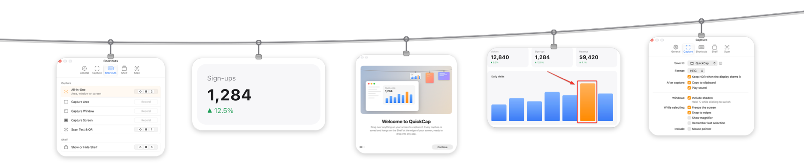
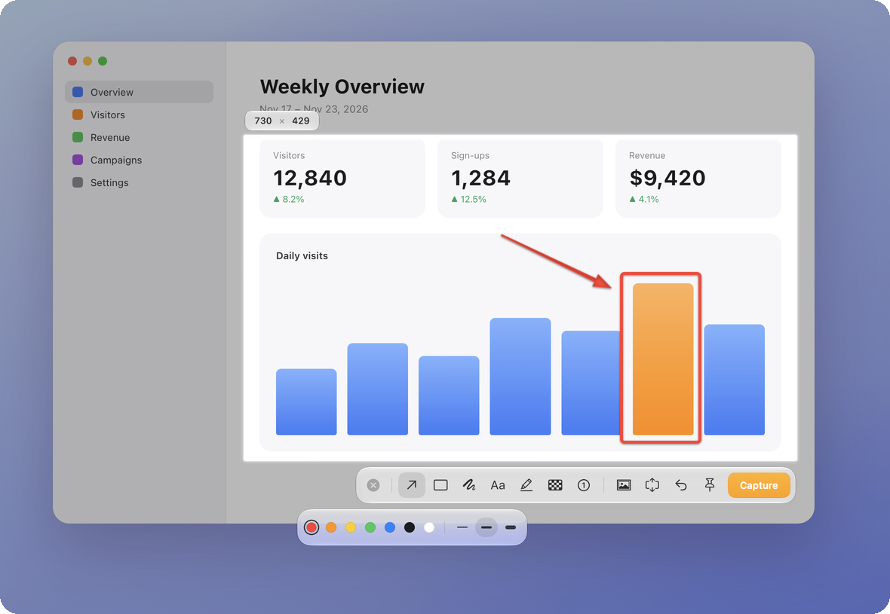
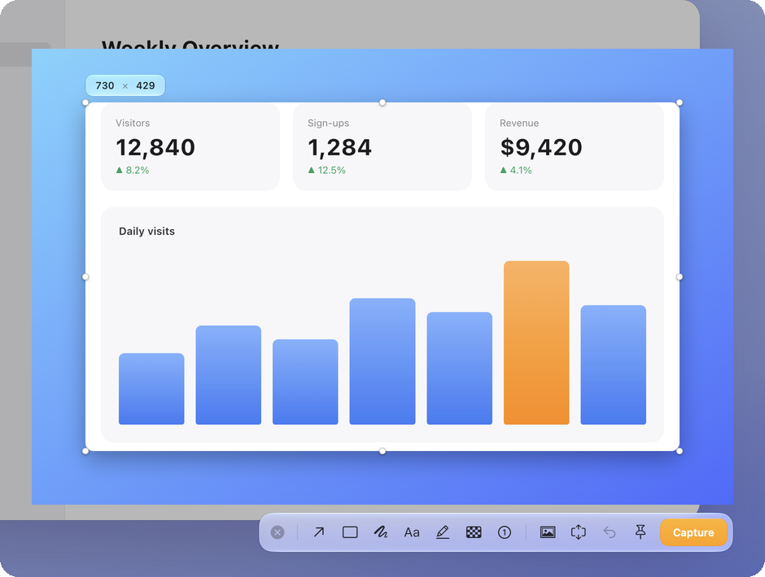
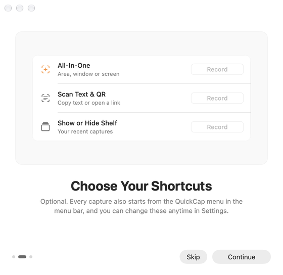
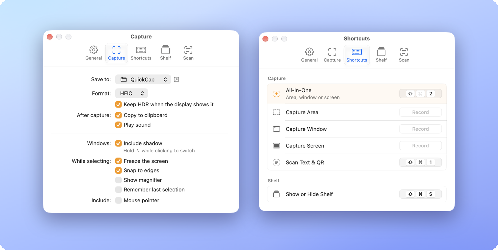

<h1 align="center">QuickCap</h1>

<p align="center">
  macOS 上的开源原生截图工具。<br/>
  截区域、窗口或整个屏幕，直接标注，识别文字和二维码，
  每张截图都挂在屏幕顶部的截图架上。
</p>

<p align="center">
  <a href="#安装">安装</a> ·
  <a href="#功能">功能</a> ·
  <a href="README.md">English</a>
</p>

---

## 简介

QuickCap 常驻菜单栏。框选屏幕上任意内容，截图就会飞上**截图架**：屏幕顶部的
一根绳子，截图用夹子挂在上面。卡片可以直接拖进任何应用，也可以复制、钉在
桌面上，或者按图里的文字搜索。不用的时候截图架会自己收起来。

<p align="center">
  
</p>

---

## 功能

### 截图和标注在同一个地方

区域、窗口、整个屏幕在同一根条上切换。选的时候画面冻结，选框会吸附窗口边缘，
也会吸附图里的线条和图形。选好后工具就在旁边：箭头、方框、画笔、文字、荧光笔、
马赛克、序号。屏幕上看到的就是存下来的样子。

<p align="center">
  
</p>

### 一键加背景

按 **G**，把截图放在渐变、桌面壁纸、纯色或透明背景上，带边距、圆角和阴影。
直接拿去做幻灯片、发推或者放进 README。

<p align="center">
  
</p>

### 不只是截图

| | |
|:---|:---|
| **识别文字和二维码** | 框选任意区域，文字或链接直接复制。用系统 Vision 框架，全部在本机完成。 |
| **滚动截图** | 自己滚动内容，QuickCap 边滚边拼接。 |
| **钉在桌面** | 截图浮在所有窗口上面，双指捏合或滚轮缩放。 |
| **窗口截图** | 带 macOS 原生阴影（按住 ⌥ 就不带），背景可以是透明的，也可以是你的桌面壁纸，动态壁纸也行。 |
| **HDR** | HDR 屏幕上截图保留 HDR 亮度（HEIC 带增益图）。 |
| **定时** | 3、5、10 秒，截菜单和悬停效果用。 |

### 快捷键你自己定

QuickCap 不会占用任何按键。欢迎窗口里可以给 All-In-One、识字和截图架设快捷键，
也可以跳过，全部从菜单栏点。之后随时在设置里改。

<p align="center">
  
</p>

### 简单的设置

保存位置、格式（HEIC、PNG、JPEG）、同时复制和保存、截图架在哪一边和自动收起、
识字语言、开机启动。

<p align="center">
  
</p>

---

## 安装

1. 在 [Releases](https://github.com/AaronKhoolb/QuickCap/releases) 页面
   下载最新的 `QuickCap-<版本>.dmg` 或 `QuickCap-<版本>.app.zip`。
2. 打开 DMG（或解压），把 **QuickCap** 拖到「应用程序」。
3. 这个 app 没有经过 Apple 公证，第一次打开会被系统拦下。可以先打开一次，
   再去 **系统设置 → 隐私与安全性** 点 **仍要打开**；或者在终端运行：
   ```
   xattr -dr com.apple.quarantine /Applications/QuickCap.app
   ```
4. 打开 QuickCap，欢迎窗口会带你完成剩下的设置。

要求：macOS 26 (Tahoe) 或更新，Apple Silicon。

---

## 许可证

MIT，见 [LICENSE](LICENSE)。

---

## 贡献者

<a href="https://github.com/AaronKhoolb/QuickCap/graphs/contributors">
  
</a>
